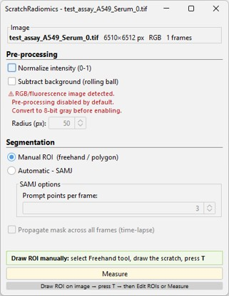

# ScratchRadiomics

**A user-friendly Fiji/ImageJ plugin for automated segmentation and radiomic analysis of scratch wound healing assays.**

[](LICENSE.txt)


ScratchRadiomics couples [SAM](https://segment-anything.com/)-based segmentation of the cell-free wound area, 
provided through the [SAMJ](https://github.com/segment-anything-models-java/SAMJ-IJ) plugin, 
with the extraction of IBSI-oriented radiomic features ([PyRadiomics](https://pyradiomics.readthedocs.io/)) 
and temporal closure descriptors. Everything is driven from a graphical interface inside Fiji, with no programming required.



---

## Table of contents

1. [Purpose](#purpose)
2. [Features](#features)
3. [Requirements](#requirements)
4. [Installation](#installation)
5. [Quick start](#quick-start)
6. [Output](#output)
7. [Example data](#example-data)
8. [Building from source](#building-from-source)
9. [Testing](#testing)
10. [Troubleshooting](#troubleshooting)
11. [License](#license)
12. [Contact and contributing](#contact-and-contributing)

---

## Purpose

The scratch (wound healing) assay is a low-cost standard method to study collective cell migration. 
Analysis of the time-lapse images is still often done by manually tracing the wound on every frame, 
which is slow and operator-dependent, while many automated tools are limited to straight wounds or report only the 
wound area.

ScratchRadiomics aims at:

- segmenting the wound **automatically** (point-prompted SAM) or **manually** (Freehand/Polygon ROIs), for linear as well as non-linear (e.g. circular) wounds;
- going beyond the wound area by computing **morphological, first-order and texture (radiomic) features** of the wound region, frame by frame;
- computing **kinetic descriptors** of wound closure for time-lapse series;
- working entirely within **Fiji/ImageJ**, the environment most biologists already use.

## Features

| Module | Description |
|---|---|
| Pre-processing | Optional intensity normalization and rolling-ball background subtraction. |
| Manual segmentation | Draw the wound with Freehand/Polygon tools; ROIs are stored in the ROI Manager. |
| Automatic segmentation | SAM-based segmentation via SAMJ (`SAM2 Tiny` default, `SAM2 Large`, `EfficientSAM`), with automatic or user-placed prompt points. |
| Time-lapse support | Mask propagation across the frames of a stack. |
| Radiomics | 2D shape, first-order statistics, GLCM, GLRLM, GLSZM, GLDZM, NGTDM, NGLDM. |
| Temporal metrics | Relative wound area, closure rate, migration velocity and wound half-life. |
| Export | Results table in Fiji and CSV export; closure-curve plot. |

2D shape features and temporal metrics are computed natively in Java; the remaining feature families are computed by PyRadiomics through an automatically managed Python environment.

## Requirements

- **Fiji** (recommended) or ImageJ2 with the Java runtime bundled in Fiji (Java 11 or later).
- **SAMJ** library (`samj-0.0.3-SNAPSHOT.jar`, provided with each release; see [Installation](#installation)).
- **Internet connection** at first use, to download the SAM model weights and the Python environment (Miniforge, about 90 MB, plus the Python packages). No administrator privileges are required.
- Supported images: 8-bit grayscale, 16-bit grayscale and RGB. Time-lapse series must be hyperstacks/stacks whose time dimension is set as *frames*. TIFF is the recommended format.
- A GPU is **not** required, although segmentation is faster with one. `SAM2 Tiny` is the lightest and CPU-friendly option.
- Operating systems: Windows, macOS (Intel and Apple Silicon), Linux (x86-64), i.e. the platforms covered by the Miniforge installers used by the plugin.

## Installation

### 1. Install Fiji

Download and unzip Fiji from <https://imagej.net/software/fiji/downloads>.

### 2. Download the two JAR files from the release

From the [Releases page](https://github.com/LorenzoRigoni/ScratchRadiomics/releases) download **both** files:

- `ScratchRadiomics-<version>.jar`: the plugin itself;
- `samj-0.0.3-SNAPSHOT.jar`: the SAMJ library used for SAM-based segmentation, provided in the release for convenience and compatibility.

### 3. Install them in Fiji

1. Close Fiji if it is running.
2. Copy **both** JAR files into the `plugins/` folder of your Fiji installation.
3. Start Fiji. The plugin appears under `Plugins > ScratchRadiomics`.
4. Open once `Plugins > SAMJ > SAMJ Annotator`, choose a model (e.g. *SAM2 Tiny*) and click *Install*. This completes the automatic setup of SAMJ (Python/Mamba environment and model weights) and only needs to be done once.

> **Note:** do not install SAMJ at the same time through the Fiji update site (`Help > Update... > Manage update sites > SAMJ`) and as a JAR in `plugins/`: two different versions of the same library may conflict. Use the JAR provided in the release.

### 4. First run

On the first use of the radiomics module, ScratchRadiomics automatically:

1. creates a user-writable data directory (e.g. `%APPDATA%` on Windows, `Library/Application Support` on macOS, `~/.local/share` on Linux);
2. downloads and installs Miniforge3 there;
3. creates an isolated Python environment and installs PyRadiomics and its dependencies (`numpy<2`, `SimpleITK`, `scikit-image`, `PyWavelets`, ...);
4. stores the interpreter path so that the following runs skip this step.

A progress dialog is shown; this can take several minutes. On machines without internet access this step will fail (see [Troubleshooting](#troubleshooting)).

## Quick start

1. Open your scratch assay image or time-lapse stack in Fiji (`File > Open...`).
2. Optionally set the pixel size and frame interval with `Image > Properties...`, so that areas and velocities are reported in calibrated units.
3. Launch `Plugins > ScratchRadiomics`. The main window opens.
4. **Pre-processing (optional)**: enable intensity normalization and/or rolling-ball background subtraction.
5. **Segmentation**: choose one of the two modes.
    - *Manual ROI*: draw the wound with the Freehand/Polygon tool and add it to the ROI Manager (`T`).
    - *Automatic - SAMJ*: select the model, set the number of *prompt points per frame* (default 3) and click **Run SAM**. If no points are provided, prompts are generated automatically inside the wound region; alternatively, place points inside the wound with the *Multi-point* tool.
6. For time-lapse stacks, tick **Propagate mask across all frames** to obtain one ROI per frame.
7. Inspect the ROIs in the ROI Manager and correct them if needed: all ROIs remain editable.
8. Click **Measure**, select the feature groups to compute and confirm. The results table is shown and can be exported to CSV.

> **Tip:** start with `SAM2 Tiny`. Switch to `SAM2 Large` only if the wound is hard to separate from the monolayer (low contrast, debris).

## Output

The results table has one row per (frame, ROI), with the columns

```
frame, roi_label, <feature_1>, <feature_2>, ...
```

Feature names are prefixed by family (e.g. `firstorder_*`, `glcm_*`, `Ftemp.*` for temporal metrics). For time-lapse series the plugin also shows a **closure-curve plot** (relative wound area, closure rate and migration velocity versus frame).

Radiomics are computed with PyRadiomics using these settings: 2D extraction (`force2D`), fixed bin count of 64, one wound label per mask.

## Example data

Time-lapse scratch assay images (A549, fibroblasts and HUVEC cells, linear and circular wounds) are publicly available on FigShare:

- Linear wounds: <https://doi.org/10.6084/m9.figshare.c.8477265>
- Circular (non-linear) wounds: <https://doi.org/10.6084/m9.figshare.c.8703151>

Files follow the naming convention `iNN_wLNN_tNN.tif` (image index, well, time point).

## Building from source

Requirements: JDK 11+, [Apache Maven](https://maven.apache.org/) 3.6+.

```bash
git clone https://github.com/LorenzoRigoni/ScratchRadiomics.git
cd ScratchRadiomics
mvn clean package
```

The shaded plugin JAR is created in `target/`. Copy it into the `plugins/` folder of Fiji.

> **Note:** `pom.xml` expects the SAMJ library as a local JAR at `lib/samj-0.0.3-SNAPSHOT.jar`, which is not tracked in the repository. Download it from the [Releases page](https://github.com/LorenzoRigoni/ScratchRadiomics/releases), create the `lib/` folder in the project root and put the file there before running `mvn clean package`.

Project layout:

```
src/main/java/com/ds4h/scratchradiomics/
├── ScratchRadiomicsPlugin.java   # Fiji entry point (Plugins > ScratchRadiomics)
├── gui/                          # Main, setup and IBSI measure dialogs
├── preprocessing/                # Normalization, background subtraction
├── segmentation/                 # SAMJ integration, ROI handling, mask propagation
├── radiomics/                    # PyRadiomics bridge, Python env manager, 2D shape, temporal features
└── output/                       # CSV export, closure-curve plot
src/main/resources/pyradiomics_runner.py   # Python helper called by the plugin
src/test/                                  # Unit tests and reference area files
```

## Testing

```bash
mvn test
```

The tests in `src/test` reproduce the validation metric on the reference data stored in `src/test/java/resources/`: they compute the Mean Percentage Absolute Difference (MPAD) between the wound areas segmented by ScratchRadiomics and the manually annotated areas, and check that it stays below the 10% acceptability threshold. A second test checks that the areas obtained with the ImageJ *Wound Healing Tool* deviate from the ScratchRadiomics ones by more than 10%. Note that the tests read pre-computed area tables (CSV); they do not run the segmentation itself.

## Troubleshooting

| Problem | Suggestion |
|---|---|
| "SAMJ requires the installation of the core components" | Copy `samj-0.0.3-SNAPSHOT.jar` from the release into `plugins/` and restart Fiji (see [Installation](#installation)). |
| "Initialize the model by Plugins > SAMJ > SAMJ Annotator" | Open the SAMJ Annotator once and install the chosen model. |
| Python environment setup fails or hangs | Check the internet connection and any proxy/firewall; make sure the user data directory is writable and has enough free space. Delete the partially created `miniforge3` folder and retry. |
| "Unsupported image type" | Convert the image to 8-bit, 16-bit or RGB (`Image > Type`). |
| Propagate option disabled | The image has a single frame; set the time dimension with `Image > Properties...` (frames). |

Please report other problems on the [issue tracker](https://github.com/LorenzoRigoni/ScratchRadiomics/issues) with the Fiji version, operating system and the content of the Fiji log window.

## License

ScratchRadiomics is free software released under the **GNU General Public License v3.0 or later**. See [LICENSE.txt](LICENSE.txt) for the full text.

## Contact and contributing

Developed at the [UNIBO Data Science for Health (DS4H)](https://github.com/UniBoDS4H/) group, University of Bologna.

- Maintainer: [Lorenzo Rigoni](mailto:lorenzo.rigoni2@studio.unibo.it>)
- Corresponding author: [Filippo Piccinini](mailto:f.piccinini@unibo.it)

Bug reports, feature requests and pull requests are welcome through GitHub Issues and Pull Requests.